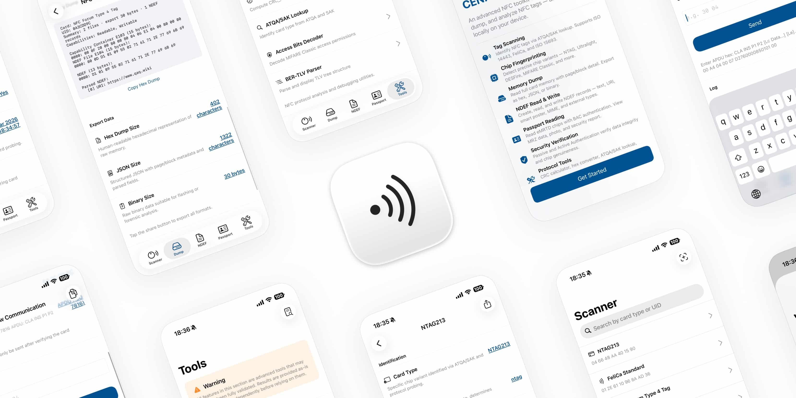

# CoreExtendedNFC

NFC protocol logic for iOS, built on top of CoreNFC.

Identify cards, read/write memory, dump tags, read eMRTD passports — async/await. The only external dependency is [openssl-spm](https://github.com/Lakr233/openssl-spm), used for passport cryptography (PACE, Passive Authentication, Active Authentication).

[](https://apps.apple.com/app/cenfc/id6760399948)



## Why This Exists

CoreNFC gives you the transport layer: session management, tag discovery, NDEF support, and raw tag-specific commands such as ISO 7816 APDUs, MiFare commands, FeliCa commands, and ISO 15693 block/custom commands.

What it does not provide is a built-in high-level protocol library. It doesn't know what an Ultralight page layout looks like, how to chain DESFire Additional Frames, how to negotiate BAC or PACE with a passport chip, or how to export a dump in Flipper or Proxmark3 formats.

This library does.

**What it covers:**

- **Card identification** — Decode ATQA + SAK bytes into 25+ card types, then refine with safe probes (Ultralight C, NTAG210/212, DESFire EV1–EV3, FeliCa Lite / Lite-S)
- **Memory operations** — Read, write, and dump tag memory across Ultralight, NTAG, DESFire, FeliCa, ISO 15693, and Type 4 NDEF tags
- **DESFire application layer** — Enumerate apps and files, handle Additional Frame chaining, authenticated reads (ISO & EV2)
- **Passport / eMRTD reading** — PACE (ECDH Generic Mapping on NIST curves) with BAC fallback, Secure Messaging, data group parsing (MRZ, face photo), Passive Authentication against your CSCA trust anchors, Active Authentication, and a per-stage security report
- **Transit cards** — Balance and history for Japan IC, Hong Kong Octopus, Singapore CEPAS, Korea KS X 6924 (including Snapper), and China T-Union
- **My Number card (Japan)** — JPKI token read, individual-number read with card-info-input-support PIN, PIN-attempt lookup
- **Crypto primitives** — CRC_A/CRC_B, AES-CMAC, 3DES, ISO 9797-1 MAC, key derivation; OpenSSL backs the elliptic-curve and CMS work
- **Dump export** — Hex, JSON, Flipper NFC, Proxmark3 MFU, and libnfc MFD formats
- **Typed errors** — Every failure is an `NFCError`; `error.isNFCCancellation` tells you to stay silent
- **Testability** — Card logic talks to the `NFCTagTransport` protocol, so it can be tested with a mock transport and no NFC hardware

**CoreNFC vs CoreExtendedNFC:**

|                                   |          CoreNFC           | CoreExtendedNFC |
| --------------------------------- | :------------------------: | :-------------: |
| Tag discovery & session           |            yes             |       yes       |
| Raw APDU send/receive             |            yes             |       yes       |
| Card identification               |          partial           |       yes       |
| Memory read/write/dump            |          partial           |       yes       |
| DESFire app/file operations       | no built-in high-level API |       yes       |
| NDEF read/write (Types 2–5)       |            yes             |       yes       |
| Passport reading & authentication |   possible, not built-in   |       yes       |
| Crypto (AES-CMAC, 3DES, MAC)      |        no built-in         |       yes       |
| Export (Flipper, Proxmark3, JSON) |        no built-in         |       yes       |
| Transport protocol for mocking    |        no built-in         |       yes       |

`partial` means CoreNFC exposes low-level or tag-specific primitives, but not a unified high-level abstraction for identification, dump orchestration, or family-specific memory models.

## Supported Cards

| Family                           | Identify | Read | Write |  Dump   |
| -------------------------------- | :------: | :--: | :---: | :-----: |
| MIFARE Ultralight / EV1 / C      |   yes    | yes  |  yes  |   yes   |
| NTAG 210 / 212 / 213 / 215 / 216 |   yes    | yes  |  yes  |   yes   |
| MIFARE DESFire EV1–EV3           |   yes    | yes  |  no   |   yes   |
| FeliCa (Type 3 NDEF)             |   yes    | yes  |  yes  | partial |
| ISO 15693 (ICODE, ST25)          |   yes    | yes  |  yes  | partial |
| Type 4 NDEF (ISO 7816)           |   yes    | yes  |  yes  | partial |
| eMRTD / ePassport                |   yes    | yes  |  no   |   no    |
| My Number card (Japan)           |   yes    | yes  |  no   |  token  |
| MIFARE Classic 1K/4K             |   yes    |  no  |  no   |   no    |

> DESFire is read-only: there is no write API, and the dump reads only free-access files, keyed by AID + file ID (Transaction MAC files are listed but not read). FeliCa dumps cover the Type 3 NDEF area plus up to 4 blocks per plain service; Type 4 dumps cover the CC and NDEF files. ISO 15693 dumps stop at block 255 (single-byte addressing) and add a `Blocks Read` fact on larger tags. Ultralight / NTAG dumps stop at the first read-protected page (AUTH0) and keep what was readable. Classic is ID-only — iOS hardware can't do Crypto1.

Real hardware coverage is tracked in [Tested Cards](docs/research/tested-cards.html).

## Quick Start

```swift
import CoreExtendedNFC

// Scan and identify
let (card, transport, session) = try await CoreExtendedNFC.scan()
print(card.type.description, card.uid.hexString)
session.invalidate()                    // or session.invalidate(errorMessage: "...")

// Scan and dump
let (info, dump) = try await CoreExtendedNFC.scanAndDump()
print(dump.exportHex())

// Read a passport (ICAO 9303 Part 11 Appendix D example key)
do {
    let passport = try await CoreExtendedNFC.readPassport(
        mrzKey: "L898902C<369080619406236",
        dataGroups: [.com, .dg1, .dg2, .sod],
        trustAnchorsDER: cscaCertificates   // DER CSCA certificates; [] skips chain validation
    )
    print(passport.mrz?.lastName ?? "?")
    print(passport.securityReport.passiveAuthentication.status)
} catch where error.isNFCCancellation {
    // The user dismissed the sheet or the task was cancelled: stay silent.
}
```

`readPassport` prefers PACE when EF.CardAccess advertises it and falls back to BAC. It reads COM and the SOD first and selects a data group only when one of them lists it. It throws when DG1 was requested but could not be read, or when nothing could be read; otherwise it returns a partial model and records each data group's outcome in `dataGroupReadStatus`. File sizes are capped (10 MB for image data groups, 64 KB for the rest).

Without `trustAnchorsDER`, Passive Authentication reports `.fallback` at best (signature not chained to a CSCA). Active Authentication is `.succeeded` only when Passive Authentication is fully verified and DG15 matches its SOD hash; a valid signature over an unauthenticated DG15 is `.fallback`. `PassportModel.reverifyingSecurity(trustAnchorsDER:)` re-runs both judgements offline on a saved model.

## Card Operations

**Ultralight / NTAG**

```swift
let cmd = UltralightCommands(transport: transport)

let version = try await cmd.getVersion()
let pages   = try await cmd.readPages(startPage: 4)
// Pages 0-3 are always guarded; memoryMap also refuses lock / config / key pages.
try await cmd.writePage(4, data: Data([0x01, 0x02, 0x03, 0x04]),
                        memoryMap: UltralightMemoryMap.forType(info.type))
// Lock, OTP and configuration pages need allowIrreversible: true (this can brick the tag).
let bulk    = try await cmd.fastRead(from: 4, to: 39)
```

**DESFire**

```swift
let desfire = DESFireCommands(transport: transport)

let version = try await desfire.getVersion()
let aids    = try await desfire.getApplicationIDs()
try await desfire.selectApplication(aids[0])
let files   = try await desfire.getFileIDs()
let data    = try await desfire.readData(fileID: files[0])
```

**NDEF**

```swift
let message = try await CoreExtendedNFC.readNDEF(info: info, transport: transport)
try await CoreExtendedNFC.writeNDEF(message, info: info, transport: transport)
try await CoreExtendedNFC.formatNDEF(info: info, transport: transport)   // Type 2 and Type 5 only
```

Type 2 and Type 5 tags must already be NDEF formatted, otherwise the write throws `NFCError.tagNotNDEFFormatted`. A message that does not fit throws `ndefCapacityExceeded(required:capacity:)`. Writing an `NDEFMessage` with no records erases the tag.

**ISO 15693**

```swift
let security = ISO15693SecurityManager(transport: iso15693Transport)
try await security.configureAFI(0x01)                          // write only
try await security.configureAFI(0x01, permanentlyLock: true)   // LOCK AFI: irreversible
```

**My Number Card (Japan)**

```swift
let data = try await CoreExtendedNFC.readMyNumberCard(
    items: [.tokenInfo, .individualNumber],
    cardInfoInputSupportPIN: "1234"
)
print(data.tokenInfo ?? "-", data.individualNumber ?? "-")
```

Official applet/data layout reference: `docs/research/my-number-card.html`

**Card Identification (pure logic, no hardware)**

```swift
let type = CardIdentifier.identify(atqa: Data([0x00, 0x44]), sak: 0x00)
// → .mifareUltralight
```

**Logging**

```swift
NFCLogConfiguration.logger = MyLogger()   // conforms to NFCLogger
NFCLogConfiguration.logPayloads = false   // default: headers, lengths and status words only
```

PIN, password and authentication exchanges are always logged as `<redacted n bytes>`, and secure-messaging APDUs log only the header and status word, even when `logPayloads` is `true`.

**Errors**

Every failure is an `NFCError` (`Equatable`). Check `error.isNFCCancellation` (user dismissed the sheet, task cancelled, or the app ended the scan) before showing an alert. See the [error reference](docs/api/errors.html).

## Installation

```swift
dependencies: [
    .package(url: "https://github.com/Lakr233/CoreExtendedNFC.git", from: "1.1.2"),
]
```

Requires iOS 15+ and a Swift 6.2 toolchain (Xcode with the iOS SDK). SwiftPM also fetches `openssl-spm`.

Your host app needs:

- `NFC Tag Reading` capability
- `NFCReaderUsageDescription` in Info.plist
- `com.apple.developer.nfc.readersession.formats` set to `TAG`
- FeliCa system codes and ISO 7816 AIDs in Info.plist as needed
- See `docs/research/info-plist.html` for copy-paste values, meanings, and public GitHub examples

See `Example/` for a working configuration.

## Architecture

```
Sources/CoreExtendedNFC/
├── Transport/     CoreNFC wrappers, NFCSessionManager, CoreNFC error mapping
├── Protocol/      CRC, card ID + refinement, APDU builder/exchange, ASN.1, NDEF, errors
├── Cards/
│   ├── MiFareUltralight/   READ, WRITE, FAST_READ, PWD_AUTH, Ultralight C auth, memory maps
│   ├── NTAG/               READ_SIG, READ_CNT, variant detection
│   ├── DESFire/            Native commands, AF chaining, app/file ops, auth, dump
│   ├── FeliCa/             Service probing, Type 3 NDEF, frame assembly
│   ├── ISO15693/           System info, block R/W, lock status, security
│   ├── Type4/              CC parsing, NDEF via SELECT/READ BINARY
│   ├── IndividualNumber/   Japanese My Number APDU flows
│   ├── Transit/            Japan IC, Octopus, CEPAS, KS X 6924, T-Union
│   └── Passport/           PACE, BAC, Secure Messaging, DG parsers, AA/PA
├── Crypto/        AES-CMAC, ISO 9797 MAC, key derivation, SHA, 3DES, secret redaction
├── Concurrency/   Lock-protected shared state
├── Logger/        NFCLogger, log store, payload redaction
├── Models/        CardType, CardInfo, MemoryDump, MRZ, PassportModel
├── Resources/     Localized strings
└── Utilities/     Hex, byte, parity
```

Only `Transport/` imports CoreNFC. Everything else is pure logic and is tested against a mock `NFCTagTransport`.

## Testing

The package is iOS-only, so tests run on an iOS Simulator:

```bash
DESTINATION="$(./Scripts/select-ios-simulator.sh)"
xcodebuild -scheme CoreExtendedNFC -destination "$DESTINATION" test
```

Test vectors are sourced from public standards (ICAO 9303, NIST FIPS, NXP datasheets, NFC Forum, RFCs).

Real-world card validation is listed in [Tested Cards](docs/research/tested-cards.html) (24 exported scans across Ultralight, NTAG, DESFire, Type 4, FeliCa, and ISO 15693 tags).

> Testing is still in early stages — most coverage is against mock transports and standard test vectors, not exhaustive real-world hardware. If you run into issues with a specific card or passport, please [open an issue](https://github.com/Lakr233/CoreExtendedNFC/issues).

## Standards

ICAO 9303 (Parts 3/10/11) · BSI TR-03110 · ISO 7816-4 · ISO 14443-3 · ISO 15693-3 · ISO 9797-1 · RFC 4493 · RFC 5652 · NFC Forum Type 2/3/4/5 · NXP AN10833

## License

MIT

## Sponsor

- [LookInside](https://lookinside-app.com/) helps you inspect a running iOS or macOS app UI from your Mac.
- This project/repository is sponsored by AFK AI, INC.
